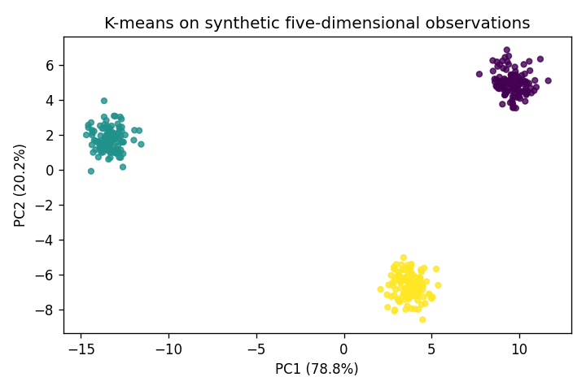

# K-means with a PCA projection

I wanted to separate clustering from the picture used to inspect it. I cluster synthetic five-dimensional observations with k-means++ initialization and Lloyd updates. I then center the same observations and use SVD to make a two-dimensional PCA projection for plotting.

From the repository root, after the main setup:

```bash
python projects/09_kmeans_pca/main.py
pytest projects/09_kmeans_pca/tests -q
```

Example output:

```text
Inertia: 1581.877 -> 752.096
Adjusted Rand score: 1.0000
Saved clusters.png
```

The run recovers the groups. I test label and center shapes, nonincreasing inertia, duplicate observations, constant-data PCA and image creation. The recovery threshold is an adjusted Rand score of 0.90. I use Agg and save the image under `results/`; `--output /tmp/clusters.png` changes its location. Empty clusters retain their previous centers. I supply the cluster count for well-separated groups. PCA can hide structure, so the image alone is not the evaluation.


