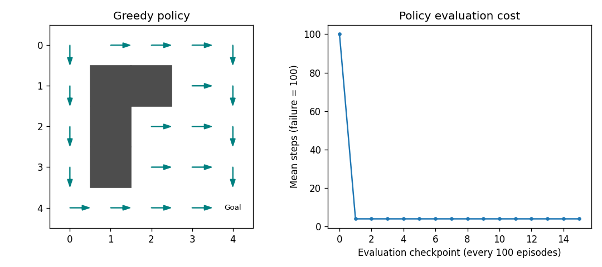

# Q-learning grid navigator

I wanted to inspect a learned policy. I implement deterministic grid transitions and tabular Q-learning with decaying exploration. Training explores reachable cells; evaluation checks the greedy policy from each start.

From the repository root, after the main setup:

```bash
python projects/10_q_learning/main.py
pytest projects/10_q_learning/tests -q
```

Example output:

```text
All-start success: 1.000; mean steps: 4.00
Policy cost: 100.00 -> 4.00
Route from 0: [0, 5, 10, 15, 20, 21, 22, 23, 24]
```

The policy reaches the goal from every start and takes eight steps from cell zero. I test collisions, terminal behavior, table shapes, reproducibility and the saved plot. My acceptance threshold is 0.95 success. The plotted loss is evaluation route cost, assigning 100 to failures; temporal-difference errors need not fall monotonically. I can change `--episodes 1500 --seed 29`. This is a deterministic toy world, not evidence of general navigation ability.


